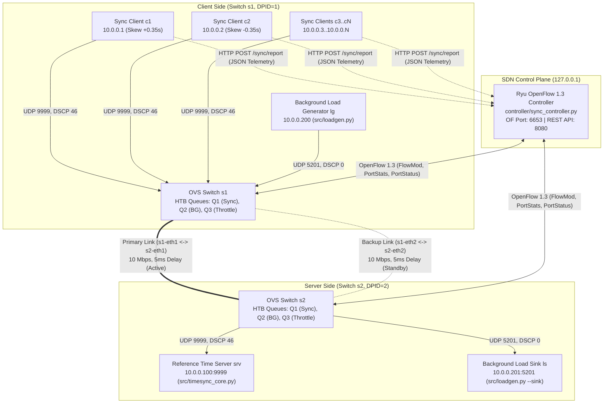

# System Architecture & Problem Statement

**Course:** Computer Networks — Jackfruit Mini Project (SDN + Socket Programming)  
**Topic No.:** 23 — Network Time Synchronization System  
**Protocol:** UDP + OpenFlow 1.3  

---

## 1. Problem Statement

Distributed applications, financial ledgers, industrial telemetry, and cluster databases require accurately synchronized clocks across networked nodes. Classical clock synchronization protocols such as the Network Time Protocol (NTP) exchange four timestamps ($T_1, T_2, T_3, T_4$) over UDP to estimate round-trip propagation delay ($D$) and clock offset ($\theta$):

$$D = (T_4 - T_1) - (T_3 - T_2)$$

$$\theta = \frac{(T_2 - T_1) + (T_3 - T_4)}{2}$$

However, this derivation relies on the **symmetric delay assumption** ($d_{\text{forward}} \approx d_{\text{reverse}}$). When background traffic saturates a network bottleneck, synchronization packets suffer variable queueing delay (bufferbloat) and asymmetric delay spikes, corrupting the offset estimate by $\frac{Q_{\text{forward}} - Q_{\text{reverse}}}{2}$ and degrading synchronization accuracy from microseconds to tens of milliseconds.

### Project Objective
Design, implement, and evaluate an **SDN-Assisted UDP Network Time Synchronization System** that:
1. Synchronizes multiple clients (each with simulated clock skew and oscillator drift) against a reference UDP time server using the 4-timestamp NTP algorithm.
2. Marks synchronization datagrams with **DSCP 46 (Expedited Forwarding, `IP_TOS = 0xB8`)** in both forward and reverse directions.
3. Deploys a **Ryu OpenFlow 1.3 SDN Controller** and **Open vSwitch (OVS) Hierarchical Token Bucket (HTB) queues** inside a **Mininet** topology to isolate time-sync packets into a high-priority low-latency queue (`Queue 1`) while throttling background traffic (`Queue 2 / Queue 3`) during congestion and automatically rerouting around link failures.

---

## 2. End-to-End System Architecture

---

## 3. Component & Role Integration

| Layer / Role | Files | Responsibilities |
| :--- | :--- | :--- |
| **Role 1: UDP Socket Engine** | `src/timesync_core.py` `src/test_multiclient.py` | 32-byte binary packet packing (`!BHIBddd`), $T_1..T_4$ timestamping, simulated software clock (`Clock` class with initial skew + 10 ppm drift), proportional offset loop (`skew += gain * offset`), DSCP 46 (`IP_TOS=0xB8`) marking on client & server, async REST telemetry reporting to Ryu controller. |
| **Role 2: Mininet + SDN Layer** | `topology/topo.py` `controller/sync_controller.py` `scripts/setup_queues.sh` `tests/test_network.py` `tests/probe.py` | Dual-switch Mininet topology with primary & backup bottleneck links, OVS `linux-htb` egress queues (`Q1`, `Q2`, `Q3`), OpenFlow 1.3 DSCP classification, 1-second port utilization polling, hysteresis congestion detection (80% / 50%), application-aware QoS escalation, and automatic link failover. |
| **Role 3: Load Gen, Automation & Analysis** | `src/loadgen.py` `experiments/run_experiments.sh` `experiments/analyze.py` `experiments/analyze_role2.py` | Configurable UDP background traffic generator & sink (`src/loadgen.py`), automated E1–E6 experiment runner (`run_experiments.sh`), statistical evaluation and plotting (`rtt_ms.png`, `jitter_ms.png`, `sync_error_ms.png`, `comparison_chart.png`). |

---

## 4. Packet Structure & Telemetry Schema

### 4.1 Binary UDP Time-Sync Packet (32 Bytes, Network Byte Order `!BHIBddd`)

| Offset | Field | Type | Size | Description |
| :--- | :--- | :--- | :--- | :--- |
| `0` | `type` | `uint8` (`B`) | 1 B | `1` = Sync Request (`REQ`), `2` = Sync Response (`RESP`) |
| `1..2` | `client_id` | `uint16` (`H`) | 2 B | Unique client identifier (`1..65535`) |
| `3..6` | `seq` | `uint32` (`I`) | 4 B | Monotonically increasing round sequence number |
| `7` | `priority` | `uint8` (`B`) | 1 B | Application priority level (default `1`) |
| `8..15` | `t1` | `float64` (`d`) | 8 B | Client request transmit timestamp ($T_1$) |
| `16..23` | `t2` | `float64` (`d`) | 8 B | Server request receive timestamp ($T_2$) |
| `24..31` | `t3` | `float64` (`d`) | 8 B | Server response transmit timestamp ($T_3$) |

*(The client records $T_4$ locally immediately upon `recvfrom()` returning).*

### 4.2 Unified CSV Log Columns (`results/client_*.csv`)

Every client logs 11 columns per synchronization round so both Role 2 (`analyze_role2.py`) and Role 3 (`analyze.py`) scripts work seamlessly:
`timestamp`, `client_id`, `seq`, `rtt_ms`, `offset_ms`, `true_error_ms`, `true_error_before_ms`, `true_error_after_ms`, `full_correction_error_ms`, `jitter_ms`, `sync_error_ms`.
