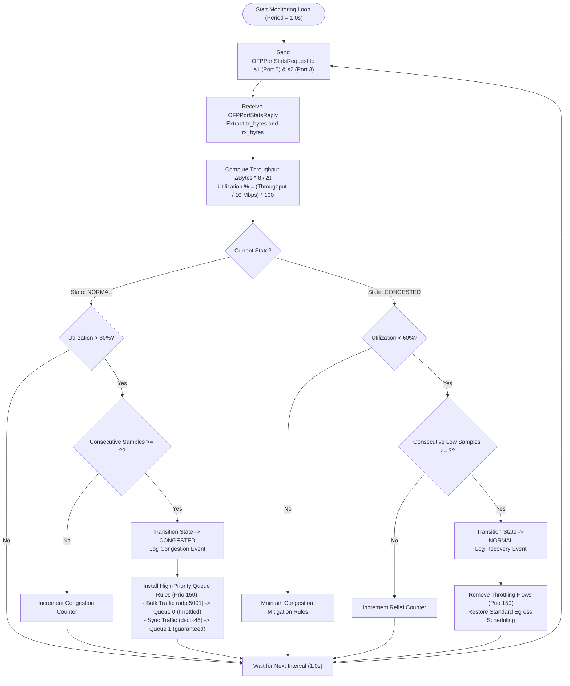

# Software-Defined Networking (SDN) Layer Architecture & Control Specification

## 1. System Overview & Topology Architecture

The Software-Defined Networking (SDN) layer of this Network Time Synchronization project decouples the network control logic from data forwarding. By employing an OpenFlow 1.3-compatible SDN controller ([Ryu](https://ryu-sdn.org/)) alongside Open vSwitch (OVS) instances in Mininet, the network dynamically prioritizes time synchronization packets (NTP-style UDP traffic) over background bulk traffic, responds to bottleneck congestion, and handles physical link failures through automated failover.

### 1.1 Complete Network Topology Architecture

The diagram below illustrates the end-to-end data plane topology, the out-of-band OpenFlow control channel, and the interaction between synchronization nodes and background load generators/sinks.

```mermaid
flowchart TD
    subgraph ControlPlane ["SDN Control Plane (Out-of-Band)"]
        Ryu["Ryu OpenFlow 1.3 Controller\n(REST API :8080 | OpenFlow :6653)"]
    end

    subgraph DataPlane ["Mininet Open vSwitch Data Plane"]
        s1["Switch 1 (s1)\nOpen vSwitch Bridge"]
        s2["Switch 2 (s2)\nOpen vSwitch Bridge"]
        
        L_primary["Primary Bottleneck Link\n(10 Mbps, 5ms delay, HTB Queues 0 & 1)"]
        L_backup["Backup Link\n(10 Mbps, 15ms delay, Failover Path)"]
    end

    subgraph Clients ["Time Sync Clients & Background Source"]
        c1["Sync Client 1\n(10.0.0.1)"]
        c2["Sync Client 2\n(10.0.0.2)"]
        cN["Sync Client N\n(10.0.0.x)"]
        h_bg["Load Generator (h_bg)\n(Bulk UDP / iperf3)"]
    end

    subgraph Servers ["Reference Server & Background Sink"]
        srv["Time Server (srv)\n(10.0.0.100 : UDP 5005)"]
        h_sink["Load Sink (h_sink)\n(iperf3 Server)"]
    end

    %% Client Connections to s1
    c1 -->|Port 1| s1
    c2 -->|Port 2| s1
    cN -->|Port 3| s1
    h_bg -->|Port 4| s1

    %% Server Connections to s2
    s2 -->|Port 1| srv
    s2 -->|Port 2| h_sink

    %% Intersplit Links
    s1 -->|Port 5| L_primary
    L_primary -->|Port 3| s2
    
    s1 -.->|Port 6 (Standby)| L_backup
    L_backup -.->|Port 4 (Standby)| s2

    %% OpenFlow Control Channel
    Ryu -.->|OpenFlow 1.3 / TCP 6653| s1
    Ryu -.->|OpenFlow 1.3 / TCP 6653| s2
```

---

## 2. Core Design Decisions and Justifications

Every architectural choice within this SDN layer was selected to model realistic wide-area network (WAN) or enterprise constraints while maintaining precise experimental control.

### 2.1 Why Two Switches? (Creation of a Realistic Bottleneck)
* **Single Switch Limitation**: In a single-switch topology (all hosts plugged into `s1`), all traffic traverses the virtual bridge's internal software backplane. Forwarding decisions execute via internal memory transfers without physical link queueing, making it impossible to establish an isolated link bottleneck with strict queue propagation delay.
* **Two-Switch Reality**: Introducing `s1` and `s2` separates traffic aggregators (clients + load generator) from destinations (server + sink). All inter-domain traffic MUST traverse the single interconnecting link (`s1-eth5 <--> s2-eth3`). This establishes a controlled, single point of congestion where buffer bloat, packet drops, and queue scheduling behavior can be rigorously measured.

### 2.2 Why Mininet `TCLink`? (Deterministic Physical Layer Control)
* Standard Mininet links use standard Linux virtual Ethernet pairs (`veth`) without traffic shaping, allowing throughput up to multi-gigabit speeds with near-zero latency.
* `TCLink` interfaces directly with Linux Traffic Control (`tc`) kernel subsystems via Netlink. It accurately configures:
  1. **Bandwidth (`bw=10`)**: Enforces token bucket rate limiting (TBF/HTB).
  2. **Propagation Delay (`delay='5ms'`)**: Uses the `netem` scheduler to delay packet egress, producing realistic round-trip times ($RTT \approx 10\text{ ms}$).
  3. **Packet Loss (`loss=X%`)**: Implements deterministic or stochastic packet dropping to simulate degraded transmission channels.

### 2.3 Why DSCP 46 (Expedited Forwarding - EF)?
* **Standardization**: Differentiated Services Code Point (DSCP) 46 (binary `101110`, hexadecimal `0x2E`) corresponds to the IETF RFC 3246 **Expedited Forwarding (EF) PHB** (Per-Hop Behavior). EF is the industry standard for low-loss, low-latency, and low-jitter real-time traffic (such as VoIP, critical telemetry, and precision clock synchronization like PTP/IEEE 1588 and NTP).
* **Wire Representation**: In IPv4, DSCP occupies the six most significant bits of the 8-bit Type of Service (TOS) octet. Therefore:
  $$\text{TOS Value} = \text{DSCP} \ll 2 = 46 \times 4 = 184 \ (\text{0xB8})$$
* **Switch Interaction**: Open vSwitch matches on `ip_dscp=46` and redirects time synchronization frames directly into the high-priority egress queue.

### 2.4 Why Queues Instead of OpenFlow Meters?
* **OVS Kernel Datapath Limitations**: OpenFlow 1.3 introduced `OFPMETER` instructions for rate limiting and policing. However, in Linux kernel datapath Open vSwitch deployments, meter support has historically been unstable, kernel-version dependent, or limited exclusively to drop-meters (policing) rather than low-latency scheduling.
* **Hierarchical Token Bucket (HTB) Queues**: OVS supports strict queuing using Linux HTB qdiscs configured on switch egress interfaces (`ovs-vsctl set port <p> qos=@qos`). HTB enables:
  * **Queue 0 (Default / Best-Effort)**: Assigned 90% bandwidth under congestion, subjected to queuing delay when filled.
  * **Queue 1 (High Priority / Sync Traffic)**: Strictly scheduled or guaranteed minimum bandwidth with near-zero buffering delay.
* By using OpenFlow `set_queue:1` actions, time packets bypass queued bulk packets completely.

### 2.5 Why an Alternate Backup Path? (Active-Standby Redundancy)
* Real-world carrier-grade and data-center networks demand path resilience. An alternate link (`s1-eth6 <--> s2-eth4`) with higher cost ($15\text{ ms}$ delay) exists in a standby state.
* If the primary link drops (e.g., fiber cut, interface error), the SDN controller dynamically detects port state degradation and reroutes flows without end-host protocol reconfiguration.

### 2.6 Why a Learning Switch Base?
* Building upon standard L2 MAC learning (`OFPFlowMod` caching of source MAC to ingress port mapping) ensures simplicity, transparency, and compatibility with standard ARP and ICMP operations.
* Synchronization logic and congestion rules are layered cleanly on top of L2 forwarding using explicit OpenFlow priority values.

---

## 3. Comprehensive OpenFlow Flow Table Specification

The OpenFlow switch maintains a flow table evaluated in descending order of rule **Priority**. Below is the complete table of all flow rules installed by the Ryu controller across switches `s1` and `s2`.

| Priority | Match Criteria | Actions | Purpose | Installation Trigger |
| :--- | :--- | :--- | :--- | :--- |
| **0** | `*` (Wildcard / Match All) | `OUTPUT:CONTROLLER` (Send to controller via `OFPP_CONTROLLER`, buffer full packet) | **Table-Miss Rule**: Forwards unknown traffic to controller for dynamic L2 learning. | Switch handshake (`EventOFPSwitchFeatures`). |
| **10** | `eth_type=0x0806` (ARP) | `OUTPUT:FLOOD` or unicast port | **Address Resolution**: Prevents ARP broadcast starvation during heavy load. | Switch initial configuration or first ARP `PacketIn`. |
| **20** | `eth_dst=<Host_MAC>` | `OUTPUT:<Learned_Port>` | **Default L2 Forwarding**: Standard forwarding rule for bulk/unclassified traffic. | Triggered by `PacketIn` after source MAC learning. |
| **100** | `eth_type=0x0800`, `ip_proto=17`, `udp_dst=5005`, `ip_dscp=46` | `SET_QUEUE:1`, `OUTPUT:<Out_Port>` (Primary: s1=p5, s2=p1) | **High-Priority Sync Request (Client $\to$ Server)**: Directs time sync queries to HTB Queue 1 on the primary link. | Installed proactively during switch feature configuration or first sync packet detection. |
| **100** | `eth_type=0x0800`, `ip_proto=17`, `udp_src=5005`, `ip_dscp=46` | `SET_QUEUE:1`, `OUTPUT:<Out_Port>` (Primary: s2=p3, s1=p_client) | **High-Priority Sync Reply (Server $\to$ Client)**: Directs sync responses into Queue 1 on reverse path to preserve low symmetric delay. | Installed proactively or upon initial server response. |
| **150** | `eth_type=0x0800`, `ip_proto=17`, `udp_dst=5001` (or iperf port) | `SET_QUEUE:0`, `OUTPUT:<Out_Port>` | **Congestion Throttle / Shaper**: When primary link utilization $>80\%$, drops or forces background bulk traffic into constrained Queue 0. | Dynamic congestion controller triggered by byte counter threshold breach. |
| **200** | `in_port=p5` (Primary down), `eth_dst=<Server_MAC>` | `OUTPUT:p6` (Backup link egress) | **Failover Divert Rule (s1)**: Immediately shunts outbound traffic to backup port `s1-eth6`. | `EventOFPPortStatus` reporting port 5 `LINK_DOWN`. |
| **200** | `in_port=p3` (Primary down), `eth_dst=<Client_MAC>` | `OUTPUT:p4` (Backup link egress) | **Failover Divert Rule (s2)**: Shunts return traffic to backup port `s2-eth4`. | `EventOFPPortStatus` reporting port 3 `LINK_DOWN`. |

---

## 4. Congestion Detection, Hysteresis, and Mitigation Flowchart

The controller periodically monitors byte and packet counters on the primary bottleneck ports using `OFPPortStatsRequest` (at an interval of $T_{\text{poll}} = 1.0\text{ s}$). Utilization is computed as:
$$\text{Utilization} = \frac{\Delta \text{tx\_bytes} \times 8}{T_{\text{poll}} \times \text{Link Capacity (bps)}} \times 100\%$$

To avoid rapid oscillating flow rule installations (flapping), a **hysteresis model** with a high watermark ($T_{\text{high}} = 80\%$) and low watermark ($T_{\text{low}} = 60\%$) is enforced:



---

## 5. Automated Link Failover and Recovery Flowchart

Link failures are handled asynchronously using OpenFlow asynchronous `OFPPortStatus` notifications. This enables sub-second reaction times without waiting for polling timeouts.

```mermaid
flowchart TD
    Event(["EventOFPPortStatus Received from Switch"]) --> ParsePort["Inspect Port Reason & State Flags\n(OFPPR_MODIFY / OFPPS_LINK_DOWN)"]
    ParsePort --> CheckTarget{"Affected Port is\nPrimary Bottleneck?"}
    
    CheckTarget -->|No| Ignore["Log Port Event & Continue"]
    CheckTarget -->|Yes| CheckDown{"Port Down or Up?"}

    %% Link Down Handling
    CheckDown -->|Port Down (Failover)| LogFail["Log Alert: Primary Link Failure Detected!"]
    LogFail --> DelPrimary["Remove Active Flows utilizing Primary Port\n(Delete flows pointing to Port 5 on s1 / Port 3 on s2)"]
    DelPrimary --> PushBackup["Install Reroute Flows (Priority 200):\n- Forward outbound to Backup Port (s1-eth6)\n- Forward inbound to Backup Port (s2-eth4)"]
    PushBackup --> VerifyBackup["Update Controller Route Cache:\nActive Path = BACKUP (Delay: 15ms)"]

    %% Link Restoration Handling
    CheckDown -->|Port Up (Restoration)| LogRestore["Log Notice: Primary Link Restored"]
    LogRestore --> Debounce["Debounce Timer (Wait 2.0s for link stability)"]
    Debounce --> RemoveBackup["Delete Override Flows (Priority 200)"]
    RemoveBackup --> ReinstallPrimary["Re-install Optimal Primary Flows (Priority 100):\nEgress via Port 5 (s1) and Port 3 (s2)"]
    ReinstallPrimary --> ResetState["Update Controller Route Cache:\nActive Path = PRIMARY (Delay: 5ms)"]
```

---

## 6. System Limitations and Future Improvements

While this architecture demonstrates significant synchronization stability under network stress, university-level technical rigor requires documenting its inherent engineering trade-offs:

1. **Single-Threaded Ryu Event Loop**:
   * *Limitation*: Ryu is built on Greenlet/Eventlet cooperative multitasking running on a single operating system thread. Under extreme packet-in storms or frequent high-resolution statistics queries, the event loop can lag, causing delayed flow table updates.
   * *Future Work*: Migrate control logic to multi-threaded or distributed controllers (e.g., ONOS or OpenDaylight) with hardware offloaded flow managers.

2. **Symmetric Delay Assumption in NTP**:
   * *Limitation*: The two-way timestamp offset calculation ($\theta = \frac{(T_2 - T_1) + (T_3 - T_4)}{2}$) assumes identical forward and reverse transmission delays ($d_{\text{fwd}} = d_{\text{rev}}$). If the forward link experiences transient queuing that the return link does not, an error of $\frac{\Delta d}{2}$ is injected directly into the clock offset calculation.
   * *Future Work*: Implement SDN in-band telemetry (INT) where switches embed hardware timestamps directly into packet headers, removing one-way transit ambiguity.

3. **Absence of Cryptographic Authentication**:
   * *Limitation*: Current UDP synchronization frames and OpenFlow REST endpoints do not authenticate frame origin. Malicious hosts can forge DSCP 46 headers to monopolize high-priority queues or inject false timestamps.
   * *Future Work*: Integrate HMAC-SHA256 authenticated payload fields (NTP Autokey or NTS standard) and TLS-secured OpenFlow/REST control channels.

4. **Queue-Only Traffic Management (Lack of Hardware Meters)**:
   * *Limitation*: Relying solely on egress HTB queues means that if non-sync hosts mark their own packets with DSCP 46, they will steal bandwidth from synchronization packets.
   * *Future Work*: Implement strict ingress access control lists (ACLs) matching `(in_port, ip_src, ip_dscp)` to strip DSCP tags from unauthorized endpoints before reaching bottleneck egress queues.

5. **Scale Limitations in Mininet Emulation**:
   * *Limitation*: Running dozens of simulated Linux network namespaces and virtual switches on a single CPU host introduces kernel scheduling jitter that can pollute sub-millisecond clock offset measurements.
   * *Future Work*: Deploy the controller against physical OpenFlow hardware switches (e.g., Edgecore with PicOS) across distributed bare-metal testbeds.
